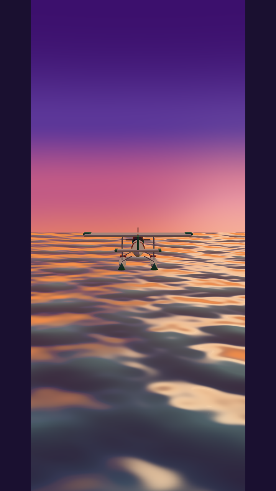
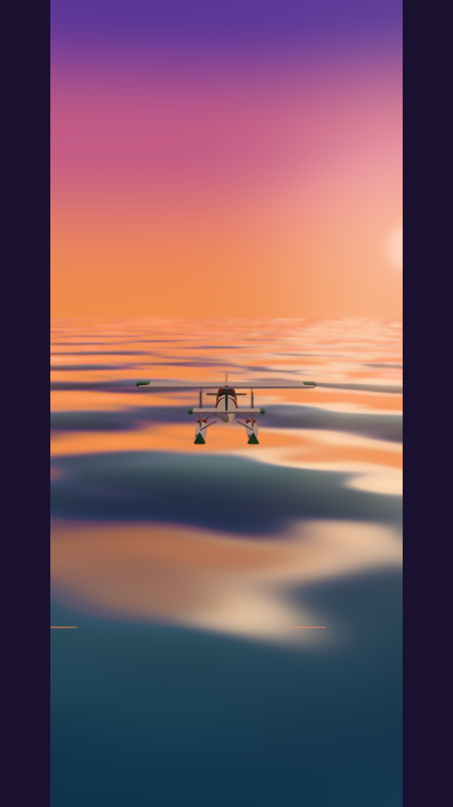
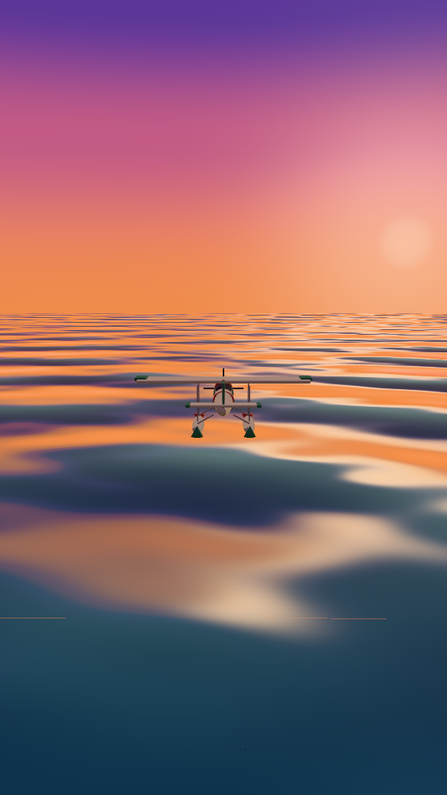
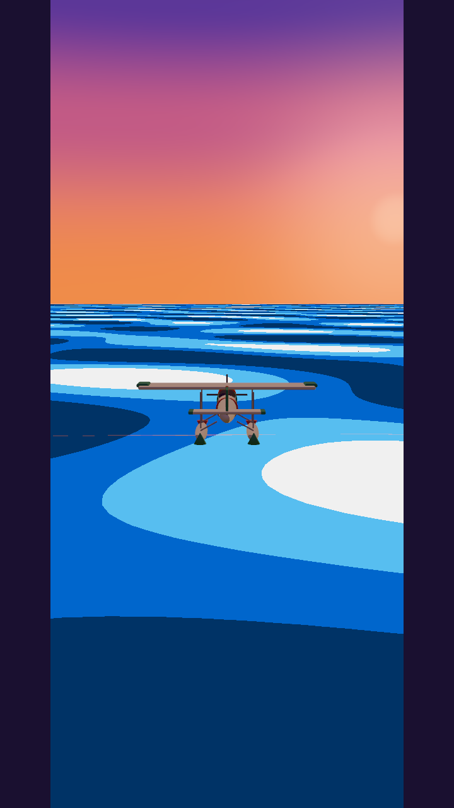
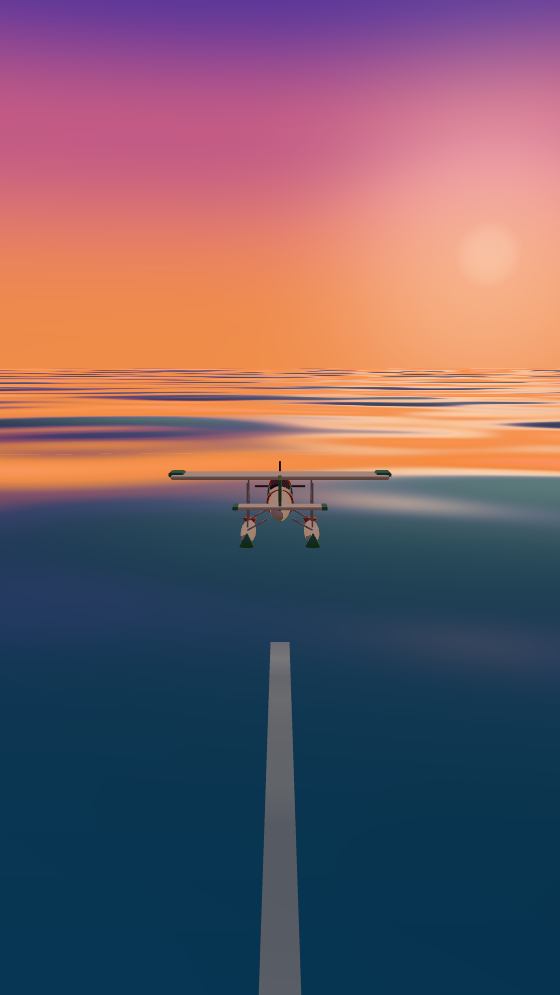
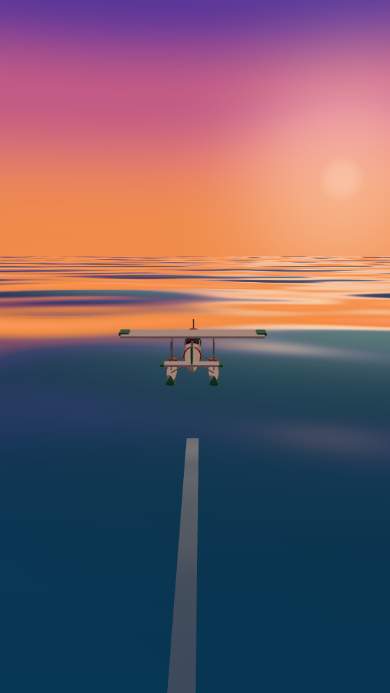
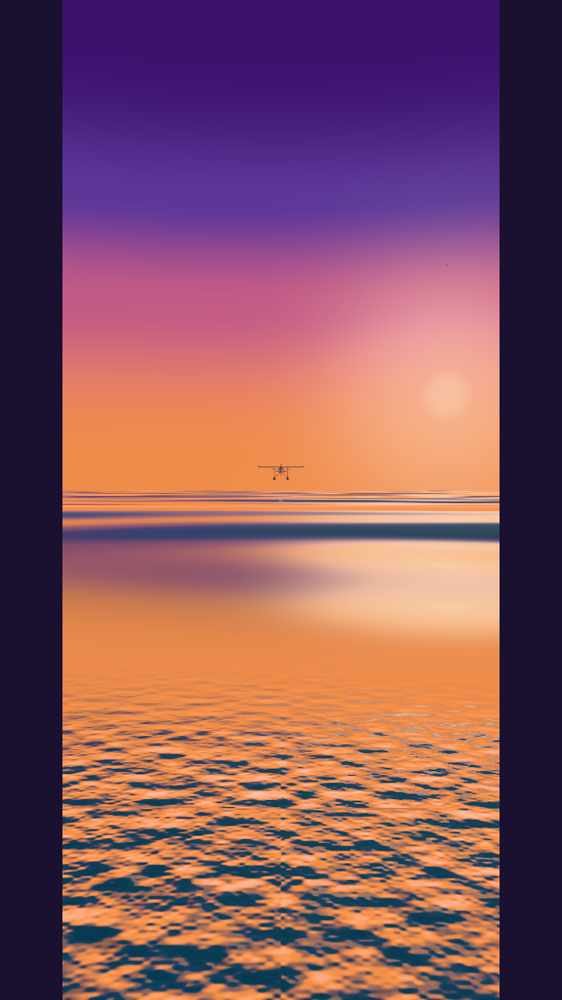
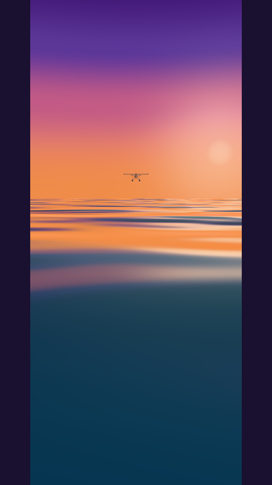
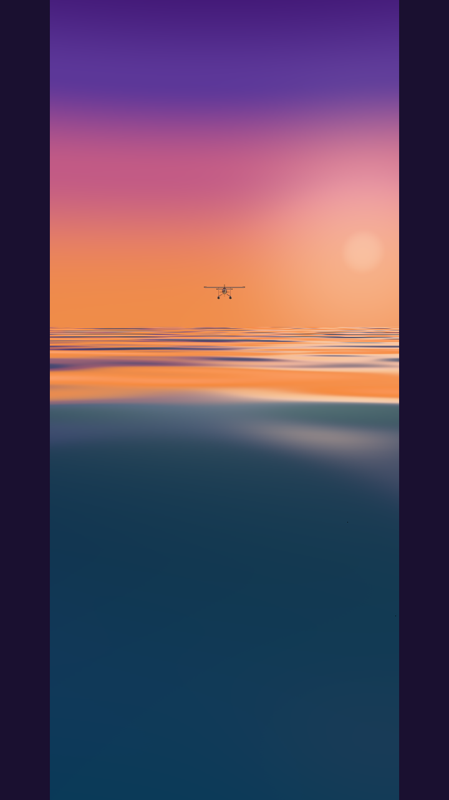

# 海面效果审核报告 —— 波浪尺度与波形可辨识度

**审核日期**：2026-11-07（**v2 修订** 2026-11-08）　|　**分支 / HEAD**：`rebuild/sea-dome-reset` / `87ac421`
**审核人**：技美（Technical Artist）视角　|　**结论**：**不通过（需返工）**

> **v2 修订记录（2026-11-08 回填复审结论）**　原件备份：`artifacts/sea-review/report-backup-2026-11-07-orig.md`。修订原则：**数字誊抄一致 ≠ 结论成立**，逐条实证后修订——
> 1. **撤回 20 m"环缝"证据**：原稿 §2.2 引用的 debug 假色跳变（y=980→985）出自唯一 debug 帧 `H020-debug`（`capture.json:570`，`?alt=20`），是 `?sea=debug` 的 step() 高度分档**等高线**（实测跨界行随 x 在 978–987 漂移，并非直线），不是环缝；20 m 机位下 128 m 环边界投影在 0.5–0.6h，与 0.766h 不相容。
> 2. **判据 3 缝半条重写**：假色里分档硬边与环缝硬边不可区分，缝的闸门改为几何 A/B（`c1Gate=0`）。**注意（2026-11-08 校准）**：原文说「钩子已在 `material.ts:444` 暴露」是错的——444 行是 `cssToLinear()` 里的 `new THREE.Color`。`c1Gate` 实际在 [`material.ts:194`](../../../src/sea/material.ts)（uniform）、`:434`（返回）、`:544`（唯一写入者，与 `tierGain` 同写）；公开句柄 `SeaOcean` 只有 `setQuality/setDebug/setVisible`，**单变量 A/B 目前无法从 `__porco` 跑**，见判据 3 备注。
> 3. **C 项重写**："没有透视加密"被自家数据反驳（std 持平 + gx/gy 同步减半 = 特征屏幕尺度 ×1.9 的正确透视响应）；近场真病因改为"缺 4–32 m 法线八度"；"物理倒挂"措辞改为透视/尺度阶梯论证。
> 4. **§6 坡度论证降级为脚注**：2πA/λ 修正（原口径少乘 π），SLOPE_GAIN 放大后法线峰值摆幅 ~17°，"坡度太小看不见浪"不成立；验收基准改取参照图 ref-01/02 的平静黄昏海，不取物理海陡度。
> 5. **度量语义修正**：`measure.py` 的 `row_stripes` 数的是"行均值梯度 >3 的行数"，不是横纹条数（`measure.py:57-62`）。
> 6. **翼展口径**：GLB 包围盒实测 10.9 m 与代码注释 11.4 m 并存待统一，比值按区间给出（见 §一）。
> 另：B 项（无可辨识轮廓）由 P1 降级 **P3**——中高空抽象斑纹属风格取舍，其客观残部（几何轮廓缺失）并入 A/C。

---

## 一、审核范围

**只审两件事**：① 波浪与飞机的尺度比例在不同飞行高度（尤其贴近 / 低空掠海）是否协调；② 海面是否呈现可辨识的波浪形态（起伏轮廓、波峰波谷、近中远层次），而非平坦或缺乏波浪形象。云、飞机建模、音频、性能、太阳光路预算均不在本次判定范围内；**未修改任何源码**。

**实地环境**：`npm run dev`（Vite 6，端口 5190）→ Chrome 156 headless，`navigator.gpu` 可用、`backend = webgpu`、three r186、quality = high、4 个 `sea-r0..r3` 网格全部在场、whiteout = 0。首轮视口 720×1280（画布 560×1280，aspect 0.4375），另以 560×995（画布 560×995，aspect 0.5625，**真 9:16**）复拍 5 个关键场景，两套口径结论一致。首轮画布偏窄来自 `index.html` 的 `max-width:560px` 在桌面尺寸视口下生效，属取景口径，不计为海面缺陷。

**状态全部走冻结协议**：`?qa=frozen` + `__porco.qa.step(N, 1/60)` + 两轮 present；HUD 隐藏；`?post=0` 为基线，另拍一帧出货后处理；`?puff=0` 隔离近景云；`?sea=debug` 假色高度分档、`?sea=0` 配对差分；`game.update` 停掉后摆自由机位取掠角/俯视证据。可复现参数与逐帧 `describe()` 存于 `artifacts/sea-review/capture*.json`，像素量测存于 `measurements.json` / `details.json`。

**判定尺**：飞机翼展在画面中实测 **287 px**（`H020-sea-off` 帧）。翼展在仓库里有**三套口径**（2026-11-08 补测）：`src/game.ts:565` 的 `spanHalf = 4.9` → 翼尖间距 **9.8 m**；GLB 包围盒实测 **10.9 m**（2026-11-07）；代码注释 **11.4 m**（`camera-rig.ts:18`、`fly-loop.test.ts:51`）。相差最大 16%，下文比值按 9.8–11.4 m 区间给出（原文只写了后两套、报「相差 4.5%」，偏窄）。波场尺取 `src/sea/cascades.ts:23-24`：C0 swell **128–1024 m / 峰值 0.45 m**，C1 chop **32–128 m / 0.10 m**。画面按高度分带量测：远 0.40–0.50h、中 0.50–0.70h、近 0.70–0.97h（近场＝飞机脚下水面）。**量具口径（v2 注）**：下文"强梯度行数"＝ `row_stripes`（`measure.py:57-62`）——带内行均值梯度 >3 的**行数**，不是可数横纹条数；中位间距 1 px 表示这些行相邻连片（连续抖动带），不是离散条纹。

| 场景 | URL / 状态 | 代表帧 |
|---|---|---|
| 高空巡航 | `?alt=240` / `?alt=120`，300 帧 | `H240-alt240.png`、`H120-alt120.png` |
| 中低空巡航 | `?alt=60`，300 帧，`?post=0` 与出货后处理各一 | `H060-alt60.png`、`H060-post-on.png`、`916-H060-alt60.png` |
| 低空 | `?alt=20`，180 帧 | `H020-alt20.png`、`H020-debug.png`、`H020-sea-off.png` |
| 贴近 / 掠海 | `?alt=7` 180 帧；`?alt=60` + 下拖 72 px 180 帧（实测 y=6.988） | `H007-alt7.png`、`SKIM-dive7.png`、`916-H007-alt7.png`、`916-SKIM-dive7.png` |
| 补充机位 | 3 m 掠角、35 m 俯视；固定机位 t=3 / t=5 | `H007-grazing.png`、`H007-topdown.png`、`MOTION-t3/t5.png` |

---

## 二、各场景观察到的具体现象

### 1. 高空 240 m / 120 m —— 有花纹，无波形；透视响应正常，缺的是更细八度

画面下半是橙、青、奶白的大块柔和斑纹，边界为无规则的云絮状，**没有一条连续的波脊、没有波峰压波谷的前后遮挡关系**，读成油膜 / 大理石 / 云影而不是水。两帧采的是同一片海（相机 x/z 相同、仅 y 不同）：近带亮度 std 42.97 → 42.20（−1.8%），而水平/垂直梯度同步减半（gx 0.387 → 0.205、gy 1.277 → 0.647）——由 std 持平 + 梯度减半推得**特征屏幕尺度 ×≈1.9**，正是世界锚定波场在高度减半时应有的透视响应（v2 更正：原稿"没有透视加密"与自家数据方向相反）。中高空的高度变化提供了正确的尺度线索；缺的不是加密，是 32 m 以下更细的八度（见 §6）。所有"细波纹"都挤在地平线附近的 1–2 px 抖动带里（远带强梯度行中位间距 1 px）。

### 2. 中低空 60 m —— 花纹最醒目；0.77h 直线大概率为环缝，证据链待 A/B 闭合

橙/奶油色斑块铺满画面中部，出货后处理（bloom + DOF）只把亮部提亮、边缘更柔，**没有生成任何新的波形结构**。画面 **0.77h** 处有一条贯穿全宽的笔直细线（真 9:16 复拍中位于 y≈770/995，同样相对位置；post=0 与出货后处理均在），把海面切成上下两层。**成因判定：大概率的 R0/R1 环缝**（`rings.ts:28-29`，128 m 边界在 ≈66.8 m 相机高度下投影 0.78–0.83h，与实测 0.77h 在口算精度内吻合，且是正常渲染中唯一的全宽直线候选）——**证据链未闭合**，待 `c1Gate=0`（`material.ts:194/434/544`；**没有公开单变量钩子**，见判据 3 备注）或单环对照帧确认后记为实锤。（v2 撤回：原稿引用的 debug 假色 y=980→985 色阶跳变出自唯一 debug 帧 `H020-debug`（`capture.json:570`，`?alt=20`）——实测跨界行随 x 在 978–987 间漂移，是 step() 分档等高线而非直线；且 20 m 机位下 128 m 边界投影在 0.5–0.6h，与 0.766h 不相容。**假色硬边是分档功能，不得用作缝证据。**）远带 69 个强梯度行（相邻连片、中位间距 1 px）；近场垂直梯度仅 0.427。

### 3. 低空 20 m —— 近场退化为低频渐变，波形为零

近带亮度 std **3.58**、水平梯度 **0.008**、垂直梯度 **0.043**、强梯度行 **0 条**（对比 60 m 的 std 33.58 / 0.134 / 0.427）——飞机脚下是低频渐变的深蓝（v2 注：std≠0，是低频渐变而非严格均匀；结论不变），全部"波纹"被压缩到 0.40–0.50h 的地平线窄带。`?sea=debug` 揭示原因：高度场在一条扫描线上只剩 **82 px 与 478 px** 两个巨大色瓣（换算地面尺度 ≈34–200 m，与 32–128 m+ 波段同量级），即整个可见海面的高度动态只跨越 2–3 个分档，不是一列波峰波谷；`?sea=0` 配对帧证明下半幅的深蓝完全由海面材质贡献，不是天空或云。

### 4. 贴近 / 掠海 7 m 与 SKIM（y=6.99）—— 两项审核点同时失效

- 近场低频渐变：垂直梯度 **0.028 / 0.024**、强梯度行 **0 条**；地平线只剩 3–6 条橙蓝相间的水平细带，看不到浪头轮廓，也没有"机翼下方一波一波掠过"的题材。
- 近带地面覆盖 ≈20–40 m（7 m 机位）：装不下半个 128 m swell、至多一个 32 m chop 周期；频谱在 32 m 以下为空、detail 法线在 ≥16.8 m 全关（见 §6）——**高度变化换不来任何尺度信息**（v2 更正：原稿"波场不随距离变密"的归因改为八度缺位 + gate 关闭）。
- 飞机下方唯一的"结构"是一条 **30–50 px 宽、硬边、不透明的灰色长条**（`porco_skim_wake` 尾迹带，`feel.ts:293`），从画面底部一直顶到机腹，读成跑道 / 板子而非浪花；它反而强化了"飞机贴着平板飞"的错觉。

### 5. 补充机位与动态对照

- **3 m 掠角**：地平线有一排可读的细横纹，但近场是密集橙色闪点（太阳路镜面反射），没有起伏轮廓；近带 140 个强梯度行全部来自闪点噪声，不是浪脊。（v2 注：3 m 处近水 3–17 m 落在 detail gate 开启区（8.4 m 内全开）——**闪点恰证明高频八度在近距可用**，反证 7 m 机位近带（≥17 m）被 gate 整段切掉。）
- **35 m 俯视**：近带 std **0.71**、强梯度行 0，0.37h 处一道硬切把反射色带与近场分开。（v2 注：近垂直视角 Fresnel 反射仅 ~2%、体色主导，"平"是水面光学的正常表现；本帧缺同机位 debug 高度跨度，**单独不构成无波证据**，仅作旁证。）
- **固定机位 t=3 → t=5**：海面 17.8% 像素亮度变化 >10、10.05% >30，说明 FFT 波场确实在演化；但变化集中在地平线色带，近带两帧 std 只有 2.75 / 1.19，仍是低频渐变。**「会动」不等于「看得出是浪」**——一条缓慢平移的明暗分界线，观感更像潮汐染色 / 色块擦除。

　

### 6. 代码侧佐证（只读，不作为改码建议）

**主机制（v2 重写）：近场平的真因是空间频率与八度覆盖，不是坡度幅度。**

- 7 m / 20 m 机位近带地面覆盖 ≈20–40 m / 40–80 m：装不下半个 128 m swell，至多一个 32 m chop 周期——近场必然落在同一相位、呈低频渐变。
- 频谱在 32 m 以下为空（两 Cascade 下限即 32 m，`cascades.ts:23-24`），**4–32 m 无法线八度**；detail 法线 gate（texel 1.56 cm，`material.ts:49-51`；闸门在 `:268-269`，`smoothstep(1,2)` on `texel/(d·radPerPixel)`；竖幅 QA 帧 radPerPixel≈9.3e-4 → **8.4 m 全开 / 16.8 m 全关**）在近带整段关闭。3 m 掠角近水 <17 m 处 gate 开启，闪点即证。
- 太阳仰角 7° → 平水 nDotL≈0.12（体色项手写 nDotL，`material.ts:305-306`；原引 `:311-313` 是 crest 辉光那段的注释），浪面倾角对体色的扰动仅 ~3/255，不可见。
- 着色由 Schlick Fresnel × 天空反射 + Beer-Lambert 体色 + 太阳路主导，波高只以 `CREST_TINT = 0.35`（`water-shading.ts:60`）参与体色。debug 色瓣（82/478 px ≈ 地面 34–200 m）与 32–1024 m 波段同量级——**斑块就是波场自身的（着色）像**，缺的是几何轮廓与近场八度，不是"另一个物"。

**脚注（v2 降级：几何坡度论证）**：单波最大坡度 = 2πA/λ：C0 ≈ 0.45·2π/128 ≈ 0.022 rad ≈ **1.27°**，C1 ≈ **1.13°**（v2 更正原稿 A/(λ/2) 口径，少乘 π）。×`SLOPE_GAIN = 14`（`water-shading.ts:86`）后法线峰值摆幅 ≈**17° / 15°**——与原稿所引 RMS≈0.1（≈5.7°）并存（RMS 与峰值是两个统计量，不矛盾）。**反射斑纹正是被放大的波形法线的像，"坡度太小所以看不见浪"不成立**；1.27° 的几何坡度给不出中高空轮廓/遮挡，此点已由主机制覆盖。验收基准取参照图 ref-01/02 的平静黄昏海——不取物理海陡度（10–20°），风格目标是"读成平静水面"。

---

## 三、问题严重程度

分级口径：**P1 阻断**（审核项不成立 / 核心镜头报废）、**P2 明显**（观感受损但不阻断）、**P3 轻微**。

| # | 问题 | 等级 | 关键证据 |
|---|---|---|---|
| A | **贴近 / 掠海时近场波形完全消失**，飞机脚下是低频渐变平面 | **P1** | 20 m 近带 std 3.58 / 强梯度行 0；7 m 与 SKIM 垂直梯度 0.028 / 0.024、强梯度行 0 |
| B | 波形仅以反射着色存在，**无几何轮廓 / 遮挡关系**；中高空抽象斑纹属风格取舍（客观残部并入 A/C） | **P3**（v2 降级，原 P1） | 几何坡度 ~1.3° 给不出轮廓；着色层有波形（法线 ×14 后峰值 ~17°） |
| C | **低空尺度线索断裂**：近带装不下半个最短波长、4–32 m 无法线八度、detail gate ≥16.8 m 全关 | **P1** | 7 m 近带 ≈20–40 m；频谱下限 32 m；gate 8.4/16.8 m；240→120 特征尺度 ×1.9（中高空透视正常，作对照） |
| D | **近中远层次断裂**：60 m 全宽直线 | **P2** | 直线存续于 post=0 / 出货 / 9:16 三口径；成因大概率环缝（投影 0.78–0.83h 吻合），待 c1Gate A/B 闭合；原 debug 证据撤回（等高线非缝） |
| E | **掠海尾迹是硬边灰板**，成为近场唯一结构 | **P2** | 30/40/50 px 宽不透明灰条贯穿下半幅（`feel.ts:293`） |
| F | 正向记录：高度场在演化、天空/雾化/太阳路衔接成立、detail 八度近距可用 | — | t=3→t=5 有 17.8% 像素变化 >10；3 m 掠角闪点 = gate 开启区工作正常；`?sea=0` 与出货后处理帧均无异常黑屏/破面 |

---

## 四、对整体视觉效果与二者协调性的影响

**整体视觉**：黄昏天穹、雾化收敛、太阳路亮带与配色本身是成立的，画面不脏不破；但海面占了竖幅约一半面积，却只提供一层"缓慢移动的抽象花纹"。缺少水的物理形态后，画面重心全压在天空与飞机上，海面退化为背景色板，日落海景最核心的"水感"没有建立。

**二者协调性**：飞机是画面中唯一稳定的尺度锚（287 px），而可读的波纹细节只存在于 1–2 px 的地平线抖动带、近场为零——观众没有任何中间尺度可以把"浪的大小"和"飞机的大小"联系起来。中高空斑块屏占比与翼展相当，只是透视的正常结果（128 m @ 240 m 与 11 m @ 40 m 同屏占比），**不构成物理倒挂**（v2 更正）；真正的断点在 ≤20 m：波场最短 32 m、近带装不下一个完整周期、4–32 m 八度缺位、detail gate 关闭——高度从 240 m 降到 7 m，中高空有正确的透视放大，低空则什么都没有；掠海镜头既没有波峰从翼下掠过的速度感，也没有贴近浪尖的危险感，读成"贴着一块蓝色平板飞"。灰板尾迹进一步把这个错觉钉死。

**性质判定**：不是"没有波"——FFT 高度场存在、波高在正常演化、假色模式能看到四个高度分档、斑块即波形法线的反射像；问题是**表现层**：几何坡度 ~1.3° 给不出轮廓，频谱缺 4–32 m 八度，近场又被 gate 切空，nDotL≈0.12 压平体色。属于尺度设计与表现层缺陷，不是模拟层缺失。

---

## 五、最终结论

**两项审核点均不通过，海面效果需返工。** 2 项 P1（低空近场波形消失、低空尺度线索断裂）+ 2 项 P2（60 m 层次硬边成因待 A/B、掠海灰板尾迹）+ 1 项 P3（中高空抽象斑纹，风格取舍）。当前版本在 240/120/60 m 尚可当作抽象风格化水面看，但**在 20 m 以下尤其是 7 m 掠海的核心镜头完全不成立**；波浪与飞机之间不存在可信的尺度关系。

复核通过的最低判据（供后续验收使用，非本次改动范围）：

1. **7 m 掠海近场出现 ≥2 个可分辨的波峰/波谷起伏**，且随 C1/gate 开关联动（证明来自波场而非噪声）；近带垂直梯度与强梯度行数脱离 0（口径：`row_stripes`，行均值梯度 >3 的行数）。
2. **屏幕尺度透视**：中高空已由数据满足（240→120 m 特征尺度 ×1.9，v2 确认）；本判据收窄至 ≤20 m 腿——补 4–32 m 八度后，近带须出现可与 287 px 翼展构成可读倍数的重复结构。
3. **60 m 直线的闸门是几何 A/B**：`c1Gate=0`（或单环对照）下该线消失/移位方可记为环缝实锤并验收"层次断裂已修"；`?sea=debug` 的 step() 硬边一律不作缝证据，debug 仅用于高度分档计数（"同一条扫描线多个连续分档"仍是合法判据）。
   **备注（2026-11-08 记账）**：这条判据现在**跑不了**，不是结论问题而是接线问题——`c1Gate` 是 `uniform(1)`（`material.ts:194`），唯一写入者是 `setQuality`（`:544`），它同时改 `tierGain`（`:541`）并停掉 C1 的 compute 派发（`:533`）；`SeaOcean` 公开句柄也没有暴露它。要闭合这条，先给 `setQuality` 旁加一个只动 `c1Gate` 的 `setChopGate(on)`（可挂 `?sea=nochop`）。单环对照（`setVisible` 关 R1）能替代一半，但会同时改远场着色。

**证据目录**：`artifacts/sea-review/`（18 张冻结帧、`capture.mjs` / `motion.mjs`、`measure.py` / `details.py`、`capture*.json` / `measurements.json` / `details.json`）。所有帧均可用对应 URL + 步数重放。v2 复核实证：像素扫描（H020-debug y=980/985 逐字节一致、跨界行横向漂移 978–987）、`capture.json:570`、`material.ts:49-51`（detail texel）、`:194`（`c1Gate`）、`:268-269`（`detailPx`/`smoothstep`）、`:305-306`（手写体色 `nDotL`）、`:434`/`:544`（`c1Gate` 暴露与写入）、`measure.py:57-62`、`rings.ts:28-29`、`water-shading.ts:60, 86`、`cascades.ts:23-24`、`feel.ts:293`。（行号 2026-11-08 校准：原文的 `material.ts:197, 311, 444` 分别是 `worldXZ`、`towardSun` 注释、`cssToLinear`，不是所指之物。）原件备份：`artifacts/sea-review/report-backup-2026-11-07-orig.md`。
